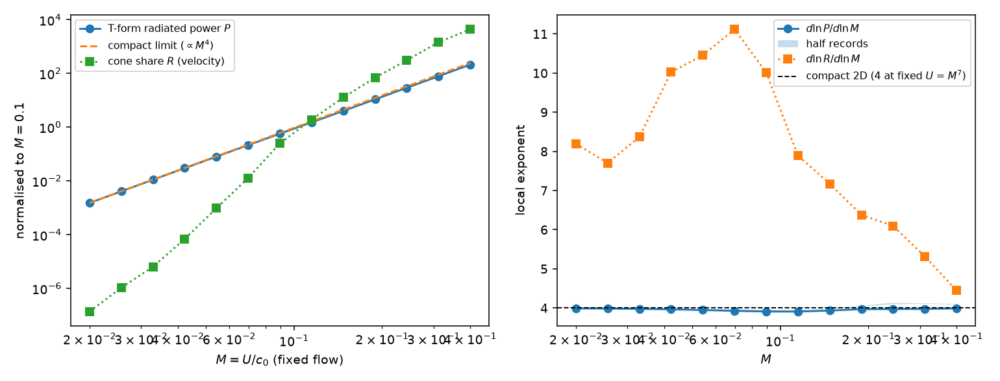
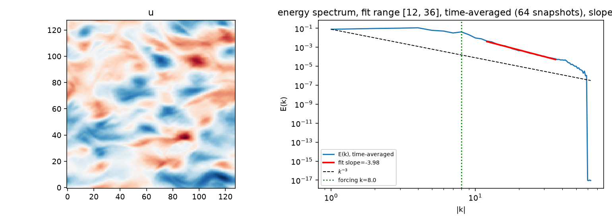
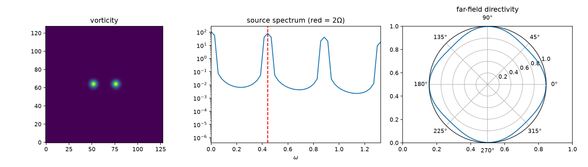

# The Silent Field

**Neural PDE surrogates lose the acoustic field — but not for the reason the literature assumes.**

Spectral bias says networks learn low wavenumbers first and lose high ones. The
acoustic field is at **low** wavenumber: at Mach number `M` the acoustic
wavelength exceeds the hydrodynamic length scale by `1/M`. By every spectral-bias
argument it should be the easiest content in the flow to learn.

It is destroyed anyway, because it is invisible in **amplitude**, not in frequency.

## What this repository is

The full pipeline behind that claim, built to be checked rather than believed:

- a forced 2D Navier–Stokes solver (pseudospectral, ~120 lines, every derivative exact on a periodic domain);
- an aeroacoustic post-processing toolkit on Lighthill's analogy — two independent source formulations, the 2D Hankel Green's function, a T-form far field, and a validation gate against a known analytic answer;
- FNO and UNet surrogates with the standard training recipes — plain MSE, Sobolev, relative H¹, and a cone-weighted objective;
- the experiments that locate the failure: the cone-share metric (`scripts/04`), the Sobolev argument (`scripts/06`), the radiated-power scaling (`scripts/08`), and a blind evaluation of trained models against trivial references (`scripts/09`–`11`).

The measurement stages are complete, hardened by a full correctness audit, and
reproduce on a laptop in minutes — no GPU. The surrogate evaluation (Stage 3) is
in progress; its numbers are provisional and the record is `stage3_log.md`. The
setting is deliberately clean: 2D, incompressible, with the Mach number an
*analysis* parameter — the flow is simulated once and listened to at any Mach.

## The measurement

A disturbance radiates only if its phase speed is supersonic, `ω/|k| ≥ c₀`. That
carves a cone out of the wavenumber–frequency plane. Turbulence does not live
there — it lives on the convective ridge `ω ≈ U|k|`, whose slope is smaller by
exactly the Mach number.


*(Energy density on the (|k|, ω) plane, `data/turb2d.npz` at M = 0.1, with the
convective ridge overlaid. The radiating cone above the sonic line holds
3.2 × 10⁻⁸ of the total.)*

An L2 loss weights every mode by its energy. So the share of the training
objective assigned to the only region that makes sound is:

| Mach | L2 objective | Lighthill source | Lighthill source, T-form (R_T) |
|------|--------------|------------------|--------------------------------|
| 0.05 | 1.8 × 10⁻¹¹  | 5.3 × 10⁻¹² | 7.5 × 10⁻¹¹ |
| 0.10 | 3.2 × 10⁻⁸   | 2.3 × 10⁻⁹  | 4.9 × 10⁻⁹  |
| 0.20 | 4.8 × 10⁻⁶   | 3.4 × 10⁻⁷  | 3.9 × 10⁻⁷  |
| 0.30 | 6.2 × 10⁻⁵   | 5.5 × 10⁻⁶  | 5.9 × 10⁻⁶  |

*(128², L = 2π, `data/turb2d.npz`, Welch 4-segment, full record:
`python scripts/04_komega_analysis.py`. Reproduces in ~3 min on a laptop.)*

The T-form column counts the radiating content below `c₀·dk` (the compact term) that the
box-mode source misses, so it is larger at low Mach (14× at M = 0.05, 1.08× at M = 0.3);
`python scripts/07_tform_metric.py`.

The steep fall of these shares with Mach is a property of the *share*, not of the sound.
The radiated power itself follows the compact 2D quadrupole law: at fixed flow its local
exponent d ln P / d ln M is 3.9–4.3 over M = 0.02–0.4 on all three datasets, i.e.
P ∝ ρU⁷ℓ/c₀⁴, the 2D "M⁷" law when U varies at fixed c₀
(`python scripts/08_mach_scaling.py`).



*(Radiated power (T-form, tapered) vs Mach at fixed flow. The local exponent sits
on 4 — the compact 2D quadrupole law — and the compact term alone (the box-integrated
stress, dashed) carries the sound: P/P_compact = 0.87–1.00 over the sweep.)*

**Sobolev training — the standard remedy for spectral bias — cannot raise this
number.** At its default weight it does not touch it at all; where it is strong enough to
matter it lowers it. That is the finding.

A Sobolev objective is a *sum* of two separately normalised terms, so the weight it
applies to each full-plane mode is `1 + λ·c·w̃(k)`, not `(1+k²)^order`. Here `w̃` is the
`(1+k²)^order` weight normalised by its own mean, `c = N_cells/N_half` on the rfft2 `kx = 0`
and Nyquist columns, and `c = N_cells/(2N_half)` elsewhere (each interior coefficient stands
for ±k). The weight's mass is at high k, where the cone has no area at all; the cone sits at
low k — it reaches only `k ≤ 6.7`, 1.2% of the resolved `|k|` values. So `w_eff ≥ 1`
everywhere and `|w_eff − 1| ≤ 1.7 × 10⁻⁴` across the entire cone at the default λ. The Sobolev
term moves the cone share by 1.3 × 10⁻⁴ at λ = 10⁻², about 0.01% of the objective:

| λ | 10⁻³ | 10⁻² (default) | 10⁻¹ | 1 | 10 | 10² | 10³ | 10⁴ | 10⁶ |
|---|------|------|------|---|---|----|----|----|----|
| share ÷ L2 | 1.000 | **1.000** | 0.999 | 0.987 | 0.883 | 0.452 | 0.134 | 0.081 | 0.075 |


(`python scripts/06_sobolev_argument.py` — no trained model, no torch, ~1 min. The
objective is within 1.3% of L2 on the cone up to λ = 1, i.e. 100× the default. The trained
objective's floor is 0.075 (~13×) at λ = 10⁶. The pure multiplicative reading, `(1+k²)^order`
as in neuraloperator's `H1Loss`, gives 0.053 (~19×); that is a different objective, not
reachable by the trained one, and what an earlier version of this file wrongly reported as
the trained one. A wavenumber-based fix cannot repair an amplitude-based blindness.)

## Method

Four pieces, each small enough to read in one sitting.

**Base flow** — forced 2D Navier–Stokes on a doubly-periodic box, in
vorticity–streamfunction form (`src/solvers/turb2d.py`):

    ∂ω/∂t + u·∇ω = ν∇²ω − μω + f,    ω = −∇²ψ,    u = ∂ψ/∂y,  v = −∂ψ/∂x,

RK4 on the advection and forcing with an exact integrating factor
exp(−(νk² + μ)Δt) carrying the stiff viscous and drag terms, 2/3-rule dealiasing
on every product. The linear drag μ is not optional in 2D: it arrests the
inverse cascade, without which the box condenses into a pair of vortices and
the statistical stationarity that the (k, ω) estimate needs is lost. The
baseline record (`data/turb2d.npz`, 128², 1024 snapshots, L = 2π) uses
ν = 5·10⁻⁴, μ = 0.08, Kolmogorov forcing f = A·k_f·sin(k_f·y) at k_f = 8,
spin-up 5000 steps, snapshot interval Δt = 0.04 — chosen so the temporal Nyquist
comfortably clears the radiating cone (dt < M·L/(2·u_rms), `acoustic_sampling_interval`).



**Acoustic source** — Lighthill's analogy rearranges Navier–Stokes into an
inhomogeneous wave equation,

    (∂²/∂t² − c₀²∇²) ρ′ = ∂²T_ij/∂x_i∂x_j,    T_ij ≈ ρ₀ u_i u_j  at low M, high Re,

and for an incompressible field the source collapses to a product of velocity
gradients, S = ρ₀ (∂u_i/∂x_j)(∂u_j/∂x_i) — minus the pressure-Poisson
right-hand side (`src/acoustics/lighthill.py`). The acoustic source is therefore
a post-hoc functional of an incompressible record: no compressible solver is
ever run, and c₀ never enters the simulation — the Mach number is purely the
knob that tilts the sonic line, so one dataset supports a whole Mach sweep. Two
algebraically identical formulations (gradient and divergence) are implemented
and cross-checked; their agreement is one of the gate's checks.

**Metrics and far field** — (|k|, ω) spectra are Welch-averaged (Hann,
4 segments) and evaluated on a radially *resolved* |k| grid, not on bin centres
(see Notes). R is the cone share of the velocity field; R_S that of the source
S = ∂ᵢ∂ⱼT_ij on the box grid; R_T that of the box-truncated stress on a
4×-refined wavenumber grid with a Tukey(0.5) taper — the only one of the three
that includes the compact term below c₀·dk (`src/acoustics/tform.py`). The far
field uses the 2D outgoing Green's function G = (−i/4) H₀⁽²⁾(kr) — Hankel of the
second kind because numpy's `rfft` implies the e^{+iωt} convention, not the
textbook e^{−iωt} — with the double divergence integrated by parts onto the
kernel (T-form, exact ∂ᵢ∂ⱼG; `src/acoustics/greens.py`).

**Surrogates** — the task is one-step mapping u(t) → u(t + Δt): an FNO
(4 spectral layers, 24 modes, width 48) and a circular-padded UNet
(base 48, depth 3), AdamW with a cosine schedule, 60 epochs (`src/models/`).
Objectives: plain MSE; the additive Sobolev objective (default λ = 10⁻²); the
standard relative H¹ loss (neuraloperator `H1Loss` convention); and
`losses.cone_window_loss`, the sonic-line-proximity objective of Experiment 5.
The architectures are deliberately stock — the claim is about the objective,
not the model, so standard, competently trained networks strengthen it.

## Stage 3 — what trained surrogates actually get wrong (in progress)

Six FNO/UNet runs (one-step MSE, three seeds; relative H¹; 4-step unrolled MSE)
are evaluated against the truth and against two trivial references: copying the
input, and noise of the same size. Checkpoints and evaluation JSONs live on
Google Drive (`MyDrive/silent-field/runs/`), not in this repository; the full
record, including all commands, is `stage3_log.md`. Provisional, at M = 0.1:

- **The flow looks right; the sound source doesn't.** Field error is 1.6–3.2%, but Lighthill-source error is 18–45%. Training improves the source only 1.1× over copying the previous snapshot.
- **The error is over-represented in the radiating cone by B ≈ 5×10³** for every MSE model, FNO or UNet (seeds within ±9%). Its signature is step-to-step jitter: a near-white frequency spectrum at the lowest wavenumbers that exceeds the true signal there by 18–226× at high ω. Aliasing is ruled out. At the highest frequencies the models radiate more sound than the real flow.
- **The standard remedies don't help.** A standard H¹ loss makes B ~20× worse. Unrolled training does not remove the jitter.
- **It is a low-Mach effect — and partly a property of the metric.** The radiating-band far-field error falls from 218% at M = 0.05 to 3.9% at M = 0.3 (FNO; UNet 120% → 2.6%); at M = 0.05 every model radiates worse than copying the input. B falls ~M⁻⁵–M⁻⁶ across the sweep, but that trend mostly tracks the truth's own cone share as the cone widens: the whitened ratio B/B_white stays ≈ 0.03–0.065 for MSE models over the whole range.
- **The ordering reproduces on a second flow** (forcing k_f = 16): MSE seeds within 4% of each other in B, H¹ 20–27× worse at every Mach.
- **Use the complex far-field error.** Comparing far-field *magnitudes* is blind to timing: copying the input scores best on it. And never rank models on a single rollout — rollout metrics are seed-dominated (radiated power 0.49–1.11 across seeds).
- **Experiment 5 (cone loss, `--loss cone`, baseline flow, seed 0, W = 32):** weighting the objective by proximity to the sonic line moves what MSE cannot: B(M = 0.1) falls 4.7–5.6×10³ (MSE) → 603 / 82 / 21 at λ = 10² / 10³ / 10⁴ (copying scores 21.5), with the field error unchanged to λ = 10³ and the source error down 29.6% → 23.8%; all pre-registered acceptance criteria pass. At M = 0.05 the radiating-band far-field error falls 218% → 94% (λ = 10³) / 83% (λ = 10⁴) against copying's 107% — but stays worse than copying at ω = 60–78, and the compact term (below c₀·dk) gets ~2× worse. Free rollout degrades with λ (P/P₀ ≈ 2 / 30 / 233).
- **The failure Mach is predictable from an error-floor crossover.** At low |k| the truth's ω-spectrum falls ~ω⁻¹⁴ near the top of the band; surrogate errors fall with local slopes −5.3 to −7.9. They cross at ω_x (MSE 21.7, H¹ 16.6, cone λ = 10⁴ 34.9), and M* = U·dk/ω_x predicts the observed failure Mach (radiating-band far-field error = 100%) across 12 Mach-swept runs: log-log Pearson 0.92, observed/predicted 1.19–1.52 (median 1.25). Field error does not predict M* (Pearson 0.26); B ranks models but exaggerates (~5000× in B for 1.9× in M*). Better losses buy real but diminishing moves: MSE → cone λ = 10⁴ shifts M* from 0.062 to 0.046 while B falls 220×.


*(`scripts/11` — left/middle: the surrogate's low-|k| error spectrum relative to
the truth's and to the copy-input baseline; the crossing point ω_x is where the
error floor meets the truth. Right: M* = U·dk/ω_x vs the observed failure Mach,
12 Mach-swept runs; marker = dataset, hollow = extrapolated.)*

## Reproduce

```bash
pip install -r requirements.txt
python -m pytest -q                       # 72 tests, all passing

python scripts/01_generate_data.py        # regenerate data/turb2d.npz if data/ is missing
python scripts/00_validate_acoustics.py    # gate: known analytic answer — must PASS
python scripts/04_komega_analysis.py       # the headline number — no model needed
python scripts/05_make_figures.py          # flow overview, energy-spectrum slope
python scripts/06_sobolev_argument.py      # why Sobolev cannot help — no model needed
python scripts/07_tform_metric.py          # T-form cone share R_T (includes sub-dk content)
python scripts/08_mach_scaling.py          # radiated power vs Mach: the compact 2D law
```

`data/` is not in git; `scripts/01` defaults reproduce the baseline dataset. The
tracked manifests `data/*.manifest.json` record each dataset's configuration and
version hash, and the training script refuses a data file whose sha256 does not
match the copy the logged runs used. The other two flows:
`--forcing-k 16 --spinup 10000 --out data/turb2d_kf16.npz`, and
`--n 256 --length 12.566370614359172 --out data/turb2d_L4pi.npz`.
The headline figure and the Sobolev argument need neither torch nor a GPU.

Stage 3 — training and evaluation (GPU; the logged runs used a free Colab T4;
checkpoints live on Drive, see `stage3_log.md`):

```bash
python scripts/02_train_surrogate.py --model fno --out runs/fno_mse_01   # --loss mse|sobolev|h1|cone, --seed, --unroll K, --smoke
python scripts/03_compute_sources.py --model runs/fno_mse_01/model.pt --out runs/fno_mse_01   # field vs source vs far-field error; --extra-machs for sweeps
python scripts/09_blindness.py --model runs/fno_mse_01/model.pt --out runs/fno_mse_01 --machs 0.05 0.1 0.2 0.3
python scripts/10_error_diagnostic.py --model runs/fno_mse_01/model.pt --out runs/fno_mse_01/diag   # jitter vs aliasing
python scripts/11_crossover.py --runs-root runs --out figures/11_crossover   # failure Mach: predicted vs observed

# Experiment 5 (cone loss; W = 32 is the decided configuration):
python scripts/02_train_surrogate.py --loss cone --cone-lambda 1e3 --cone-window 32 --cone-stride 16 --cone-batch 1 --out runs/fno_cone
```

## The validation gate

`scripts/00` radiates a co-rotating vortex pair — a case with a known analytic
answer — and checks the pipeline against it: the tone lands at exactly **twice**
the orbital frequency (rotating quadrupole; measured 2.000), the far-field phase
winds with **azimuthal mode number 2** (measured −2.005 — the *magnitude* is
nearly axisymmetric because the pattern spins), the kernel is the 2D one (mean
|p′| ratio between r = 40L and r = 160L is 2.0002, not the 4.00 a 3D 1/r kernel
would give), and the wave is outgoing (dφ/dr matches −k to 0.03%). A
resolution-convergence check forecloses "your source error is really
discretisation error": rms(S) changes by 5 × 10⁻³ from n = 64 → 128 and by
1 × 10⁻⁸ from n = 128 → 256. CHECK 5 compares the exact-kernel S-form and T-form
far fields at the tone in L = 2π and 4π boxes: the gap is the box surface term,
0.0526 → 0.0073, and the check asserts < 2% at 4π and a ≥ 3× fall with L.
Nothing downstream is trustworthy without this gate passing.



## Notes for anyone reading the code

Seven things in here were bugs and are worth knowing about if you write your own
version:

- **Parseval normalisation.** FFT power needs dividing by `N_total²`, not
  `N_total`. Invisible on a log-scale plot; inflates every energy by ~10⁵.
- **Radial bin centring.** Bins must be centred *on* multiples of `dk`, not
  starting at them, or a half-bin bias tilts the apparent phase speed and
  corrupts the radiating fraction.
- **Masking a binned spectrum.** Fixing the bin centring is not enough. A cone
  condition evaluated at bin *centres* tests every mode in a bin against the wrong
  `k`: on a square grid one bin holds several distinct `|k|` (5, √26 and √29 all
  land in the bin centred on 5). Near the cone edge that admits a slab of
  non-radiating modes — measured, it inflated the headline number by 2.7× (2.8× on
  a single full-record Hann estimate). The
  metric therefore runs on a radially *resolved* grid (`KOmegaSpectrum.k_resolved`),
  not the binned one. `radiating_mask` is kept for plotting only.
- **Rotating-quadrupole directivity.** A co-rotating pair radiates a *spinning*
  pattern, so `|p'|` at the tone frequency is nearly axisymmetric. Testing the
  magnitude for four lobes returns a near-null for a perfectly correct answer;
  the structure is in the phase.
- **Selecting a frequency band by array index.** `[i for i in range(...)][:24]`
  picks the 24 *lowest* frequencies, which at M = 0.1 are all below `c₀·dk` — the
  lowest frequency that can radiate at all. On `data/turb2d.npz`, **0 of 24** were
  supersonic, and 91% of the source's ω > 0 power is down there on the convective
  ridge. Select by the radiation condition; see `greens.select_band`.
- **The S-form far field in a periodic box.** The space-derivative form
  (Sarkar & Hussaini 1993, Eq. 1) includes a surface dipole from the nonzero velocity at the
  box edge, an artifact of the boundary conditions; the time-derivative form (Eq. 2)
  gives the quadrupole sound of a finite volume of turbulence in a medium at rest.
  Use the T-form (`greens.far_field_pressure_ibp`). On a vortex pair with net circulation the
  gap is 5.26% at L = 2π and falls with box size; on turbulence it was 7–168×.
- **Hard box truncation leaks into small k.** Cutting a finite box out of the stress puts
  convective-ridge content into low wavenumbers through the box sinc. Taper the box edge
  (Tukey 0.5) before estimating sub-`dk` radiation; see `tform.cone_share_refined`.

An eighth entry is a feature: the two Lighthill formulations (gradient form and double
divergence) are algebraically identical for solenoidal fields, so their
disagreement is a free **under-resolution detector** — 1.2 × 10⁻⁸ at n=96 with a
0.18 core, 7 × 10⁻¹⁵ at n=128.

## What would work — and what is still open

The diagnosis suggests its own fix: weight the objective by proximity to the
sonic line in (k, ω) rather than by `|k|`. That needs a time window to define ω,
so it is a multi-step objective — now implemented as
`losses.cone_window_loss` (`scripts/02 --loss cone`), with pre-registered
acceptance criteria. Experiment 5's first sweep confirms the mechanism — the
cone term moves the radiating-band error where MSE cannot — and exposes its
limits (amplitude-blindness inside the cone, degrading free rollout). What
remains open, in the order they should be attacked:

- a **whitened cone weight** — the uniform cone weight is amplitude-blind inside
  the cone, which is why ω = 60–78 stays worse than copying; normalise by the
  truth's PSD;
- a **noise-injection baseline** — the standard robustness recipe, untested here;
- **rollout stability** — the cone term makes free rollout worse with λ; it may
  need unrolling or noise injection combined in, or reporting as a genuine limit;
- **replication** — more seeds, the W = 16 window variant, and the k_f = 16 flow,
  before any of the above is believed.

## Layout

```
src/spectral.py            exact periodic derivatives, Helmholtz projection
src/acoustics/lighthill.py source term, two independent formulations
src/acoustics/komega.py    (k,ω) spectra, sonic line, THE metric
src/acoustics/radiating.py loss weighting: L2 vs the trained Sobolev objective
src/acoustics/greens.py    2D Hankel Green's function, far field, radiating band
src/acoustics/tform.py     T-form cone share R_T (sub-dk included), radiated power
src/solvers/               2D NS (pseudospectral), vortex pair, IO
src/models/                FNO, UNet, losses (incl. cone-window), vanilla training
src/diagnostics/           spectra, spurious dilatation, the error triple
scripts/00–11              gate, data, train, evaluate, analyse (see Reproduce)
notebooks/                 chapter-by-chapter rerun of the whole history (old commit beside current code, every logged number asserted)
tests/                     72 tests, all passing
```

## References

- M. J. Lighthill, "On Sound Generated Aerodynamically. I. General Theory,"
  *Proc. R. Soc. Lond. A* **211**, 564–587 (1952) — the analogy the pipeline implements.
- S. Sarkar & M. Y. Hussaini, *Computation of the sound generated by isotropic
  turbulence*, ICASE Report No. 93-74, NASA CR-191543 (1993) — Eq. 1 (space-derivative
  form) vs Eq. 2 (time-derivative form); the periodic-box surface term and the
  "finite volume of turbulence in a medium at rest" treatment in `tform.py`.
- S. Schoder, E. Bagheri, H. Vincent & T. Brunner, "Generalised Perturbed Convective
  Wave Theory," arXiv:2608.19236 (2026) — secondary source for the 2D compact-quadrupole
  "M⁷" scaling at fixed c₀ (they cite Ffowcs Williams 1969).
- The relative-H¹ loss convention followed by `losses.h1_loss` is neuraloperator's
  [`H1Loss`](https://github.com/neuraloperator/neuraloperator).

---

Author: Sajeed Hussain, Contact: sajeedhs26@gmail.com
