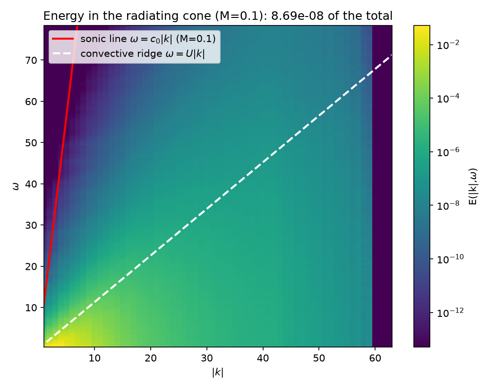
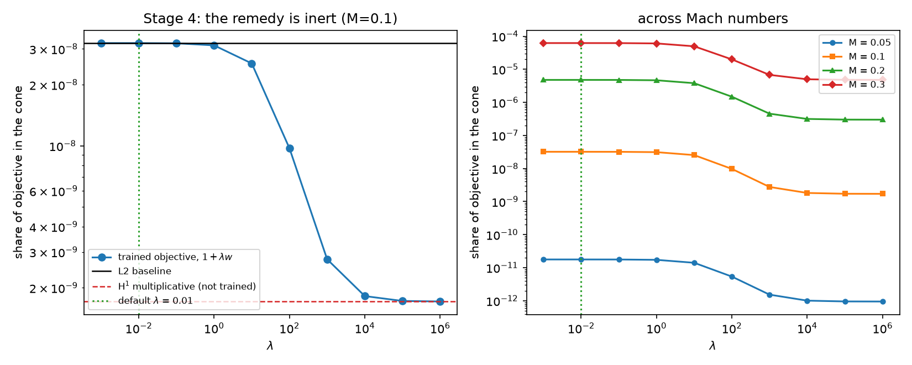
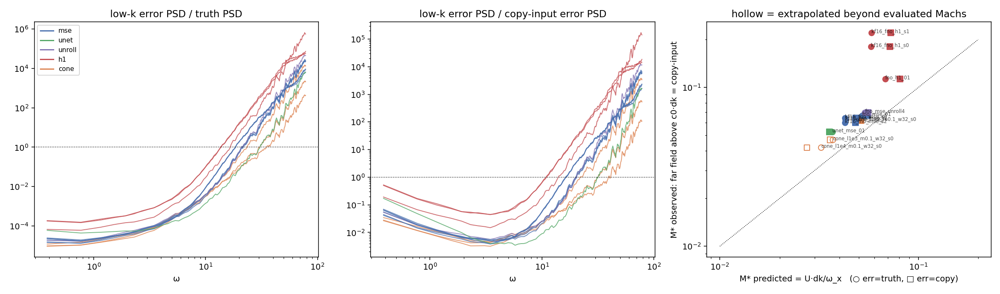

# The Silent Field

**Neural PDE surrogates trained on standard objectives lose the sound at low Mach number, and spectral bias is not the reason.**

Spectral bias says networks learn low wavenumbers first and lose high ones. The acoustic
field is at **low** wavenumber: at Mach number `M` the acoustic wavelength exceeds the
hydrodynamic length scale by `1/M`. By that argument it should be the easiest content in
the flow to learn.

It is lost anyway, because it is invisible in **amplitude**, not in frequency. The radiating
part of the flow carries about 10⁻⁸ of the energy at `M = 0.1`, so a loss that weights modes
by energy has almost nothing to fit there.

**Status.** The measurement and its validation are complete and reproduce on a laptop in
minutes, no GPU. The trained-surrogate evaluation (Stage 3) is in progress and its numbers
are provisional.

## The measurement

A disturbance radiates only if its phase speed is supersonic, `ω/|k| ≥ c₀`. That carves a
cone out of the wavenumber–frequency plane. Turbulence does not live there; it lives on the
convective ridge `ω ≈ U|k|`, whose slope is smaller by exactly `M`.



*Energy density on the (|k|, ω) plane at M = 0.1, convective ridge overlaid. The radiating
cone above the sonic line holds 3.2 × 10⁻⁸ of the total.*

Define `R` as the fraction of a field's energy that lies inside the cone. An L2 loss weights
every mode by its energy, so `R` is the share of the training objective assigned to the only
region that makes sound:

| Mach | 0.05 | 0.10 | 0.20 | 0.30 |
|------|------|------|------|------|
| R (L2 objective) | 1.8 × 10⁻¹¹ | 3.2 × 10⁻⁸ | 4.8 × 10⁻⁶ | 6.2 × 10⁻⁵ |

`python scripts/04_komega_analysis.py`, about 3 minutes. Computed on the Lighthill source
stress instead of the velocity, the share is 2–5 × 10⁻⁹ at `M = 0.1` (`scripts/07`).

The steep fall with Mach is a property of the *share*, not of the sound. Radiated power at
fixed flow follows the compact 2D quadrupole law, local exponent d ln P / d ln M = 3.9–4.3
on all three datasets (`scripts/08`).

## Why Sobolev training cannot fix it

Sobolev training is the standard remedy for spectral bias. It cannot raise this number: at
its default weight it does not touch it, and where it is strong enough to matter it lowers it.

The objective is a *sum* of two separately normalised terms, so each mode gets weight
`1 + λ·c·w̃(k)`, where `w̃` is the `(1+k²)^order` weight normalised by its own mean. That
weight's mass sits at high `k`. The cone reaches only `k ≤ 6.7`, 1.2% of the resolved `|k|`
values, so across the whole cone the weight differs from 1 by at most 1.7 × 10⁻⁴ at the
default `λ = 10⁻²`.

| λ | 10⁻² (default) | 1 | 10² | 10⁴ | 10⁶ |
|---|------|---|-----|-----|-----|
| cone share ÷ L2 cone share | 1.000 | 0.987 | 0.452 | 0.081 | 0.075 |



`python scripts/06_sobolev_argument.py`, no model, no torch. A wavenumber-based fix cannot
repair an amplitude-based blindness.

## What trained surrogates get wrong (Stage 3, provisional)

Setup: an FNO and a UNet learn the one-step map `u(t) → u(t+Δt)`, with stock architectures,
three seeds, MSE and relative-H¹ objectives, plus a 4-step unrolled variant. They are scored
against the truth and against trivial references. The runs used a free Colab T4. Checkpoints
and per-run evaluation JSONs are not in this repository, so the numbers below come from my
runs and cannot be reproduced from a clone alone; the commands to regenerate them are under
Reproduce.

Two quantities are used throughout:

- **B = R(error) / R(truth)**: the cone share of the velocity error divided by the cone share
  of the true field. `B = 1` means the error is distributed like the signal; `B ≫ 1` means it
  is over-represented in the radiating cone. `B_S` is the same ratio for the Lighthill stress.
- **Controls**, because a large `B` can come from step-to-step jitter rather than from the
  objective: `copy_input` (predict `t+1 = t`), `white_matched` (truth plus white noise of the
  model's error size, giving `B_white`) and `shuffled_error` (the model's own error in random
  time order, which destroys temporal coherence).

Results at `M = 0.1`:

- **The flow looks right; the sound source does not.** Field error is 1.6–3.2%, but
  Lighthill-source error is 18–45%. Training improves the source only 1.1× over copying the
  previous snapshot.
- **The error sits in the cone.** `B ≈ 5 × 10³` for every MSE model, FNO or UNet (seeds within
  ±9%), carried by step-to-step jitter. Relative H¹ makes it about 20× worse; unrolled
  training does not remove the jitter. Part of the size of `B` is the tiny denominator: the
  models' `B` is 0.03–0.065 of `B_white` over the whole Mach range.
- **It is a low-Mach effect.** The radiating-band far-field error falls from 218% at
  `M = 0.05` to 3.9% at `M = 0.3` (FNO; UNet 120% → 2.6%). At `M = 0.05` every model radiates
  worse than copying the input. The ordering reproduces on a second flow (`k_f = 16`).
- **The failure Mach is predictable.** On the lowest wavenumber shell the radiating band starts
  at `ω = U·dk/M`. The truth's ω-spectrum there falls much faster than the surrogate's error,
  so the two cross at some `ω_x`, and the surrogate fails once `M ≤ M* = U·dk/ω_x`. Across
  12 Mach-swept runs `M*` tracks the observed failure Mach (far-field error = 100%) with
  log-log Pearson 0.92 and observed/predicted of 1.19–1.52. Field error does not predict it
  (Pearson 0.26).



Two measurement lessons: compare the *complex* far field, since magnitudes are blind to timing
and copying the input scores best on them; and never rank models on a single rollout, since
rollout metrics are seed-dominated.

## Validation

`scripts/00` radiates a co-rotating vortex pair, which has a known analytic answer, and
checks the pipeline against it. The tone lands at exactly twice the orbital frequency
(measured 2.000). The far-field phase winds with azimuthal mode number 2 (−2.005). The kernel
is the 2D one: the pressure ratio between `r = 40L` and `r = 160L` is 2.0002, not the 4.00 a
3D kernel would give. The wave is outgoing (`dφ/dr` matches `−k` to 0.03%). The source is
resolution-converged: rms(S) changes by 1 × 10⁻⁸ from `n = 128` to `256`. Nothing downstream
is trustworthy unless this gate passes.

Bugs found along the way, and why they matter, are in [`docs/pitfalls.md`](docs/pitfalls.md).
Three of them:

- **Parseval.** FFT power is divided by `N_total²`, not `N_total`; the error inflates every energy by ~10⁵.
- **Masking a binned spectrum.** Testing the cone condition at bin centres admits non-radiating modes and inflated the headline number 2.7×. The metric runs on a radially resolved `|k|` grid.
- **Picking a band by array index.** The 24 lowest frequencies at `M = 0.1` all sit below `c₀·dk`, the lowest frequency that can radiate. 0 of 24 were supersonic.

## Method

- **Base flow.** Forced 2D Navier–Stokes on a doubly periodic box, vorticity–streamfunction
  form, pseudospectral with RK4, an exact integrating factor for viscosity and drag, and
  2/3-rule dealiasing (`src/solvers/turb2d.py`). The linear drag arrests the inverse cascade,
  which otherwise condenses the box into a vortex pair and destroys the stationarity the
  `(k, ω)` estimate needs. Baseline: 128², 1024 snapshots, Kolmogorov forcing at `k_f = 8`;
  full configuration in `data/*.manifest.json`.
- **Acoustic source.** Lighthill's analogy, `(∂²/∂t² − c₀²∇²) ρ′ = ∂ᵢ∂ⱼTᵢⱼ`, evaluated
  after the fact on the incompressible record. No compressible solver is run and `c₀` never
  enters the simulation, so the Mach number is an analysis parameter: simulate once, listen
  at any Mach. Two algebraically identical formulations are implemented and cross-checked
  (`src/acoustics/lighthill.py`).
- **Metrics and far field.** `(|k|, ω)` spectra are Welch-averaged. `R` is the cone share of
  the velocity, `R_S` of the source on the box grid, and `R_T` of the box-truncated stress on
  a 4×-refined grid with a Tukey taper; only `R_T` includes content below `c₀·dk`. The far
  field uses the 2D outgoing Green's function `(−i/4) H₀⁽²⁾(kr)`, with the double divergence
  integrated by parts onto the kernel (`src/acoustics/`).
- **Surrogates.** FNO (4 spectral layers, 24 modes, width 48) and a circular-padded UNet
  (base 48, depth 3), AdamW with a cosine schedule, 60 epochs. Objectives: MSE, additive
  Sobolev, relative H¹, and a cone-window loss. The architectures are deliberately stock: the
  claim is about the objective, not the model.

## Reproduce

```bash
pip install -r requirements.txt
python -m pytest -q

python scripts/01_generate_data.py         # only if data/*.npz is missing
python scripts/00_validate_acoustics.py    # gate; must PASS
python scripts/04_komega_analysis.py       # the headline number
python scripts/06_sobolev_argument.py      # why Sobolev cannot help
python scripts/07_tform_metric.py          # R_T, includes sub-dk content
python scripts/08_mach_scaling.py          # radiated power vs Mach
```

`data/*.npz` is not in git. The manifests record each dataset's configuration and hash, and
the training script refuses a data file that does not match. The headline figure and the
Sobolev argument need neither torch nor a GPU.

Stage 3 needs a GPU (the runs used a free Colab T4):

```bash
python scripts/02_train_surrogate.py --model fno --out runs/fno_mse_01   # --loss mse|sobolev|h1|cone, --seed, --unroll K
python scripts/03_compute_sources.py --model runs/fno_mse_01/model.pt --out runs/fno_mse_01   # --extra-machs for sweeps
python scripts/09_blindness.py --model runs/fno_mse_01/model.pt --out runs/fno_mse_01 --machs 0.05 0.1 0.2 0.3
python scripts/10_error_diagnostic.py --model runs/fno_mse_01/model.pt --out runs/fno_mse_01/diag
python scripts/11_crossover.py --runs-root runs --out figures/11_crossover

# cone loss (W = 32 is the main configuration)
python scripts/02_train_surrogate.py --loss cone --cone-lambda 1e3 --cone-window 32 --cone-stride 16 --cone-batch 1 --out runs/fno_cone
```

## What would work, and what is open

The diagnosis suggests its own fix: weight the objective by proximity to the sonic line in
`(k, ω)` rather than by `|k|`. A first sweep (`--loss cone`) confirms the mechanism: at
`M = 0.1`, `B` falls from about 5 × 10³ (MSE) to 21 at `λ = 10⁴`, matching copying the input
(21.5), with field error unchanged up to `λ = 10³`. It also exposes limits: the uniform cone
weight is amplitude-blind inside the cone, and free rollout degrades as `λ` grows. Open, in
the order to attack them:

- a **whitened cone weight**, normalised by the truth's spectrum;
- a **noise-injection baseline**, the standard robustness recipe, untested here;
- **rollout stability** under the cone loss;
- **replication**: more seeds, the `W = 16` window, and the `k_f = 16` flow.

## Layout

```
src/acoustics/   Lighthill source, (k,ω) metric, Green's function, T-form far field
src/solvers/     2D Navier–Stokes, vortex pair, dataset IO
src/models/      FNO, UNet, losses (including the cone-window loss), training
scripts/         00–11: gate, data, training, evaluation, analysis
tests/           unit tests for each of the above
docs/            pitfalls.md
```

## How this was built

The question, scope and direction are mine: I set the constraints (a result a reader can
reproduce on a laptop in minutes), chose which experiments to run and replicate (the second
flow, the cone-loss window), and ran the GPU experiments and the tests myself. Claude
(Anthropic) wrote the code and the audits, and gave its own analysis of the outputs along the
way. It helped me correct my mistakes. None of the analysis here rests on Claude's reasoning
alone.

## References

- M. J. Lighthill, "On Sound Generated Aerodynamically. I. General Theory," *Proc. R. Soc.
  Lond. A* **211**, 564–587 (1952).
- S. Sarkar & M. Y. Hussaini, *Computation of the sound generated by isotropic turbulence*,
  ICASE Report No. 93-74, NASA CR-191543 (1993). Source of the periodic-box surface-term
  treatment in `tform.py`.
- S. Schoder, E. Bagheri, H. Vincent & T. Brunner, "Generalised Perturbed Convective Wave
  Theory," arXiv:2608.19236 (2026). Secondary source for the 2D compact-quadrupole scaling.
- The relative-H¹ loss follows neuraloperator's
  [`H1Loss`](https://github.com/neuraloperator/neuraloperator).

---

Author: Sajeed Hussain · sajeedhs26@gmail.com
